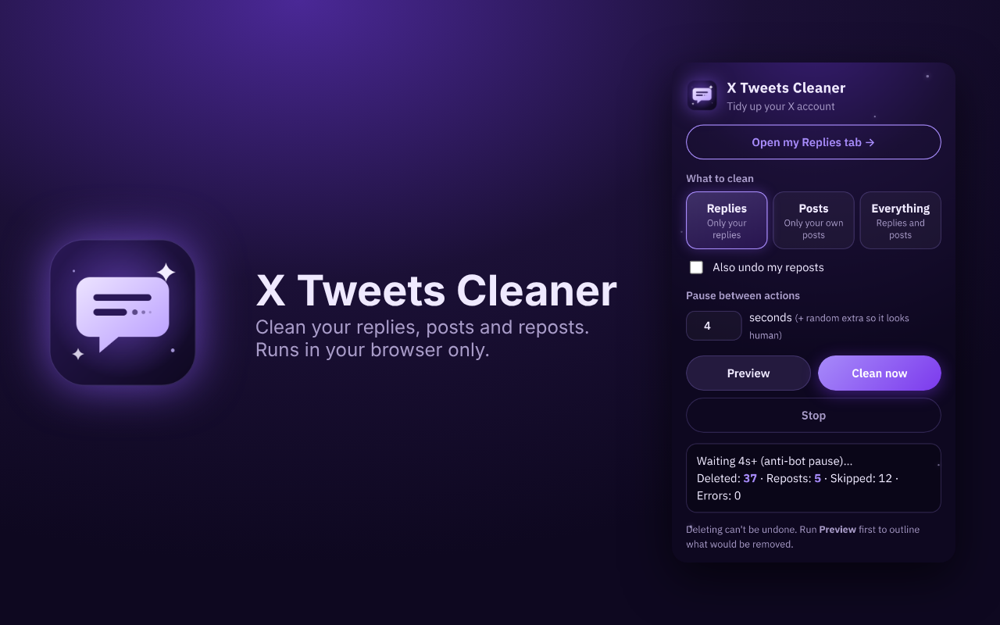

<p align="center">
  
</p>

<h1 align="center">X Tweets Cleaner</h1>

<p align="center">
  Clean up your X (Twitter) account from your browser: bulk-delete your replies, your posts, or both, and undo your reposts.<br>
  Works in <b>Brave</b>, <b>Chrome</b> and <b>Edge</b>. No API keys, no login, no servers.
</p>

<p align="center">
  
</p>

## Features

- **Choose what to clean:** only replies, only posts, or everything
- **Undo reposts** (optional)
- **Preview mode:** outlines what would be removed before anything is deleted
- **Human-like pacing:** a 4-second pause plus a random extra between actions, and an automatic cool-down if X starts throwing errors
- **Stop at any time** from the popup or the on-page panel
- Works with X in **English and Arabic**
- **100% local:** collects no data and sends nothing anywhere

## Install

### Option 1: Windows installer
1. Download `XTweetsCleaner-Setup.exe` from [Releases](../../releases).
2. Run it. When it finishes, it opens a short setup guide.
3. In `brave://extensions`, turn on **Developer mode**, click **Load unpacked**, and pick the folder the guide shows you.

### Option 2: Manual
1. Download or clone this repo.
2. Open `brave://extensions` (or `chrome://extensions` / `edge://extensions`).
3. Turn on **Developer mode**, click **Load unpacked**, and select the `extension` folder.

## How to use

1. Log in to **x.com**.
2. Click the extension icon, then **Open my Replies tab**.
3. Choose **Replies**, **Posts** or **Everything**, and tick **Also undo my reposts** if you want.
4. Press **Preview** to check what will be removed (outlined in purple).
5. Press **Clean now**. Keep the tab open while it works.

> ⚠️ Deleting can't be undone. Always run Preview first.

## Notes

- Pinned posts are skipped on purpose.
- X sometimes stops loading very old posts on the profile page. If it finishes early, reload the page and run it again.
- It works by clicking X's own buttons, so if X changes its page layout, an update may be needed. Please open an issue if that happens.

## Project layout

```
extension/   the browser extension (Manifest V3)
installer/   NSIS script and assets for the Windows installer
store/       Chrome Web Store listing text, icon, promo images
design/      source icon (SVG)
```

## Build the installer

Install [NSIS](https://nsis.sourceforge.io/), then run:

```
cd installer
makensis XTweetsCleaner.nsi
```

After the extension is published on the Chrome Web Store, add its ID at the top of `XTweetsCleaner.nsi` (`!define WEBSTORE_ID "..."`) and rebuild. The installer will then make Brave, Chrome and Edge install it from the store automatically.

## Privacy

X Tweets Cleaner doesn't collect, store or send any personal data. Your settings are saved only in your browser's local extension storage.

## License

[MIT](LICENSE) © Rami | icrptd
