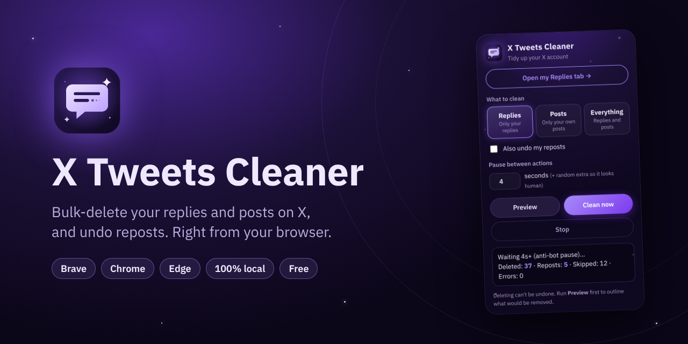

<p align="center">
  
</p>

<p align="center">
  <a href="../../releases/latest"></a>
  
  
  <a href="LICENSE"></a>
</p>

<p align="center">
  <b>Clean up your X (Twitter) account in a few clicks.</b><br>
  Delete your replies, your posts, or both, and undo your reposts. No API keys, no password, no servers.
</p>

<p align="center">
  <a href="../../releases/latest"><b>⬇️ Download</b></a> ·
  <a href="#-how-to-use"><b>How to use</b></a> ·
  <a href="#-بالعربي"><b>بالعربي</b></a>
</p>

---

## ✦ Features

| | |
|---|---|
| 🎯 **Pick what to clean** | Only replies, only posts, or everything |
| 🔁 **Undo reposts** | Optional: removes your reposts too |
| 👀 **Preview first** | Outlines everything that would be removed, without deleting anything |
| 🐢 **Human-like pacing** | 4-second pause plus a random extra between actions, with an automatic cool-down if X pushes back |
| ⏹️ **Stop any time** | From the popup or the floating panel on the page |
| 🌍 **English & Arabic X** | Works whichever language your X is set to |
| 🔒 **100% local** | Collects nothing and sends nothing; it just clicks X's own buttons for you |

## 📦 Install

### Windows installer (easiest)
1. Download **`XTweetsCleaner-Setup-1.0.0.exe`** from the [latest release](../../releases/latest).
2. Run it. When it finishes, a setup guide opens.
3. In `brave://extensions`, turn on **Developer mode**, click **Load unpacked**, and pick the folder the guide shows you.

### Manual
1. Download **`x-tweets-cleaner-extension.zip`** from the [latest release](../../releases/latest) and unzip it.
2. Open `brave://extensions` (or `chrome://extensions` / `edge://extensions`).
3. Turn on **Developer mode**, click **Load unpacked**, and select the unzipped folder.

## 🚀 How to use

1. Log in to **x.com**.
2. Click the extension icon, then **Open my Replies tab**.
3. Choose **Replies**, **Posts** or **Everything**, and tick **Also undo my reposts** if you want.
4. Press **Preview** to see what would be removed. Posts get a purple outline and reposts a blue one.
5. Press **Clean now**, and keep the tab open while it works.

> [!WARNING]
> Deleting can't be undone. Always run **Preview** first.

## 💡 Good to know

- Pinned posts are skipped on purpose.
- X sometimes stops loading very old posts on the profile page. If it finishes early, reload the page and run it again.
- If X keeps throwing errors, raise the pause to 6–10 seconds.
- It works by clicking X's own buttons, so a change to X's page layout may need an update. Please [open an issue](../../issues) if that happens.

## 🌙 بالعربي

**X Tweets Cleaner** إضافة للمتصفح (Brave وChrome وEdge) تنظّف حسابك في إكس: تحذف ردودك أو تغريداتك أو الاثنين، وتقدر تلغي إعادات النشر بعد.

- **اختر وش تبي تحذف:** الردود فقط، أو التغريدات فقط، أو الكل
- **المعاينة:** تحدد لك كل شي بينحذف قبل ما تحذف أي شي
- **وقت انتظار 4 ثواني** بين كل حذف وحذف مع وقت عشوائي زيادة، عشان ما تبان مثل البوت
- **كل شي يصير على جهازك:** ما تحتاج كلمة مرور ولا مفتاح API، وما يُرسل أي بيانات

**طريقة التثبيت:** حمّل ملف التثبيت من [آخر إصدار](../../releases/latest) وشغّله، وبيفتح لك دليل يشرح الخطوات.

> ⚠️ الحذف ما يتراجع عنه. سوّ **معاينة** أول.

## 🛠️ For developers

```
extension/   the browser extension (Manifest V3)
installer/   NSIS script and assets for the Windows installer
store/       Chrome Web Store listing text and images
design/      source icon (SVG)
```

To build the installer, install [NSIS](https://nsis.sourceforge.io/) and run `makensis installer/XTweetsCleaner.nsi`.

## 🔒 Privacy

X Tweets Cleaner doesn't collect, store or send any personal data. Your settings stay in your browser's local extension storage.

## 📄 License

[MIT](LICENSE) © Rami | icrptd
